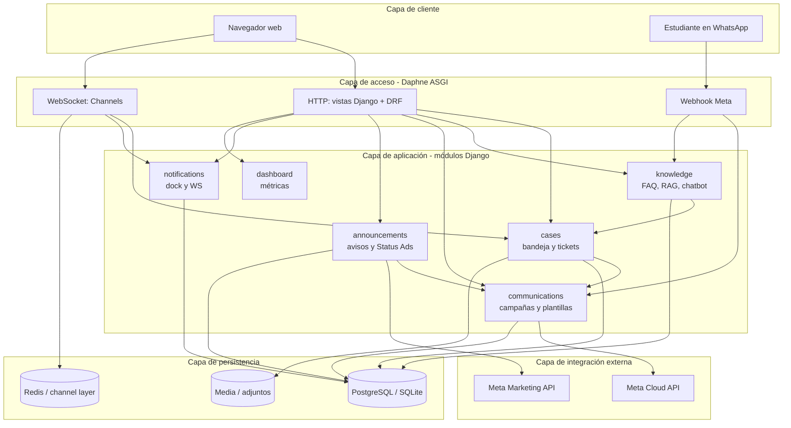
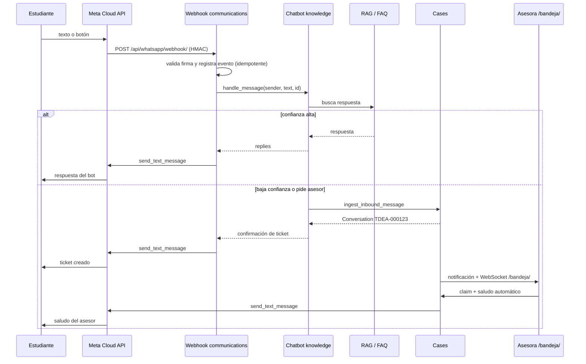
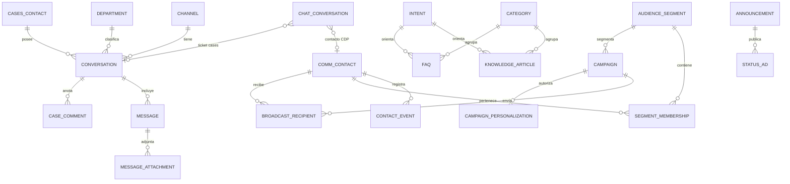
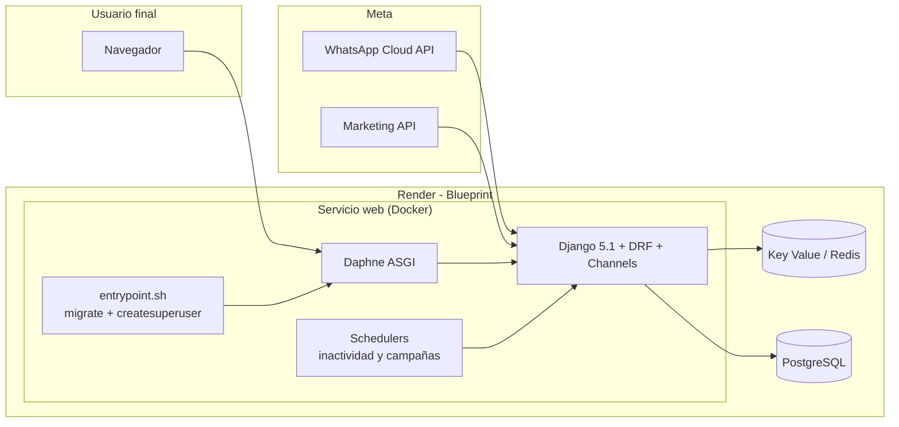
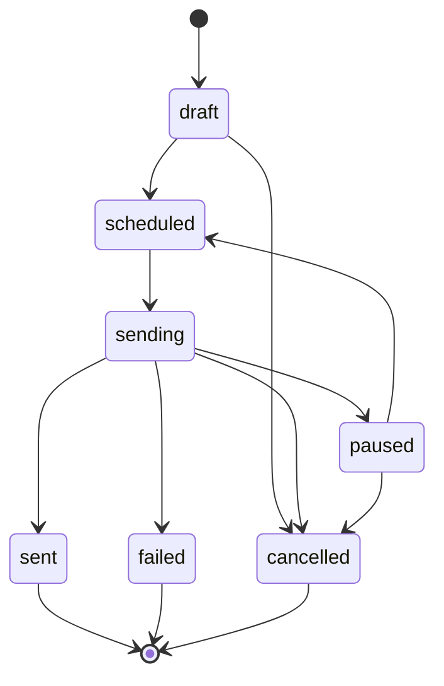

# Diagramas de arquitectura — Punto TdeA

Diagramas generados con [Mermaid](https://mermaid.js.org) a partir de las fuentes `.mmd` de esta carpeta. GitHub renderiza los bloques directamente; para exportar SVG/PNG ver [`README.md`](README.md).

## 1. Capas y componentes

Vista lógica del sistema: cliente, acceso (Daphne/HTTP/WS/webhook), módulos de negocio, integración externa y persistencia.

## 2. Flujo WhatsApp de punta a punta

Desde el mensaje del estudiante hasta la atención humana: webhook → chatbot/RAG → escalación a cases → bandeja → respuesta Meta.

## 3. Modelo de datos

Entidades y relaciones entre apps. Ojo: `CASES_CONTACT` y `COMM_CONTACT` son modelos distintos.

## 4. Despliegue en Render

Blueprint (`render.yaml`): web Docker + Key Value + PostgreSQL, con `entrypoint.sh` y schedulers incrustados.

## 5. Ciclo de vida de una campaña

